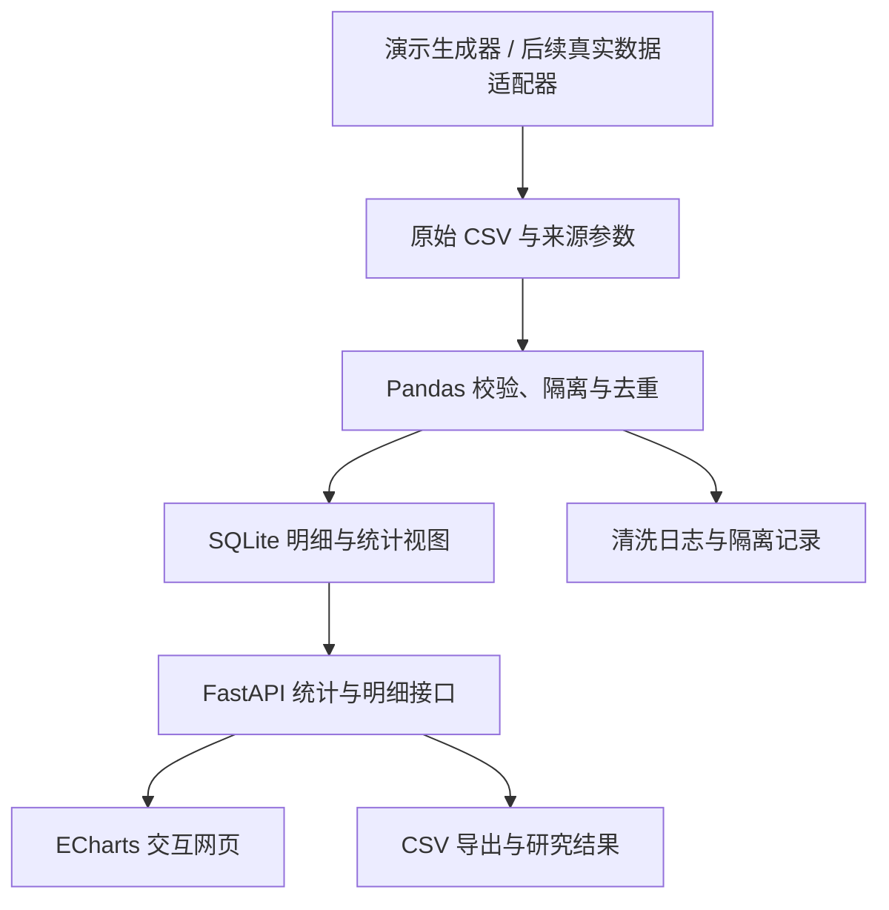
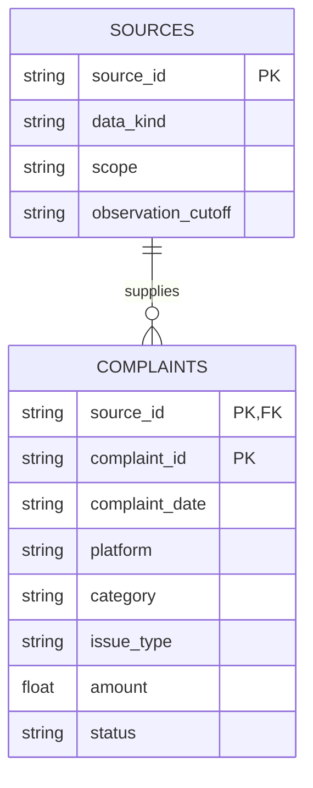

# 基于 Python 的网络购物消费者投诉特征分析与 Web 可视化系统设计

> 项目完整方案与从零复现指南  
> 版本：v1.0｜编制日期：2026-10-13  
> 当前阶段：使用演示数据验证方法与系统；真实数据接入作为后续独立阶段。  
> 本文中的模拟样本、虚构平台和场景参数均不能作为真实市场结论。

## 目录

1. 项目定位与题目选择
2. 原纲要的修正
3. 研究对象、信息对象与研究边界
4. 研究问题与分析设计
5. 数据方案与演示数据生成
6. 技术架构与数据库设计
7. 网页功能与图表设计
8. 论文结构与写作安排
9. 从零搭建与运行
10. 验证与复现实验
11. 真实数据接入路线
12. 进度安排、交付清单与答辩
13. 参考来源
14. 附录：最小可运行项目完整源码

---

## 1. 项目定位与题目选择

### 1.1 推荐题目

**《基于 Python 的网络购物消费者投诉特征分析与 Web 可视化系统设计》**

副标题可选：**——以实物商品投诉为研究对象**。

如果最终仍只有模拟数据，建议明确写为：

**《基于演示数据的网络购物投诉统计分析与 Web 可视化系统设计》**。

题目中的“统计分析”对应研究工作，“系统设计”对应工程工作。采用第二种题目时，结论重点应为统计方法的实现、数据质量治理和系统复现效果，不能宣称发现了真实中国网购市场的规律。是否满足学校毕业论文要求，应尽早由导师确认；如果学校要求真实实证分析，需要补充一组口径清楚的真实数据。

### 1.2 一句话介绍

面向网络零售实物商品投诉，构建一套可以追溯数据来源、统一统计口径、按时间与品类等条件筛选、展示投诉结构并导出结果的 Python 分析与网页可视化系统。

### 1.3 使用者与使用场景

| 使用者 | 需要回答的问题 | 系统提供的支持 |
| --- | --- | --- |
| 论文研究者 | 某段时间内，什么投诉问题占比较高？ | 统一指标、筛选条件、图表和明细 |
| 平台售后分析人员 | 某品类的投诉结构有什么特点？ | 品类与类型交叉表、平台内部结构对比 |
| 教师或答辩评委 | 数据如何生成、清洗、计算与展示？ | 生成参数、清洗日志、接口和复现步骤 |
| 普通消费者 | 样本中出现了哪些常见纠纷？ | 问题说明与样本特征；不提供平台风险评级 |

现阶段网页是教学与研究原型，不接收真实消费者提交投诉，也不承担纠纷处理业务。

### 1.4 工作量与专业契合

研究工作约占一半：界定对象、核查口径、设计指标、分析结构差异、解释局限。

技术工作约占一半：生成与清洗数据、设计数据库、实现统计接口、开发网页、验证结果与复现。

与数据科学与大数据应用专业的对应关系：

| 专业内容 | 本项目体现 |
| --- | --- |
| 关系数据库 | 主键、来源表、索引、参数化查询、聚合视图 |
| 数据仓库 | 原始层、明细层、应用统计层；来源与版本管理 |
| 应用统计学 | 描述统计、占比、变化幅度、交叉分析、效应量 |
| 数据可视化 | 图表选型、分母说明、筛选联动、热力图 |
| Python 数据处理 | CSV、Pandas、数据校验、可复现脚本 |
| 数据安全与治理 | 不采集个人身份信息、来源标记、演示数据隔离 |

约 1.2 万条演示记录不构成“大数据规模”。可以体现数据治理和多维分析能力，但不宜写成“海量数据平台”。无需为了专业名称强行加入 Hadoop、Spark 或深度学习。

---

## 2. 原纲要的修正

### 2.1 先纠正统计口径

核查原始公开通报后，以下数字不能直接组成一条趋势线：

| 原表述或数字 | 核查后的含义 | 使用方式 |
| --- | --- | --- |
| 2023 年 1740.3 万件 | 全国市场监管部门受理的各类消费投诉，不限网购 | 仅用于一般消费投诉背景 |
| 2023 年 1261.1 万件 | 全国 12315 平台接收的网购投诉举报合计 | 可作为网购投诉举报背景 |
| 2025 年 1506.7 万件 | 全国 12315 平台接收的网购投诉举报合计 | 可作为网购投诉举报背景 |
| 2025 年 1144.7 万件 | 上述网购投诉举报中的投诉部分 | 与合计数分别管理 |
| 退款问题 21.98% | 网经社 2025 数字零售报告中的“任意仅退款”；样本包括消费者和商家 | 不作为消费者退款难占比 |

依据见第 13 节 [1]—[3]。2024 年对应数值本方案未录入，不通过同比倒推补成官方记录。

“投诉”“举报”“咨询”“纠纷案例”应分别编码。全国全部消费、网络购物、数字零售与实物商品也不是同一范围。

特别注意：商家针对平台“任意仅退款”的投诉，与消费者因退款困难产生的投诉，是不同主体和不同业务问题。

### 2.2 将预设结论改成研究问题

删除提前写死的结论：

- 不预设投诉一定持续增长。
- 不预设退款一定排第一。
- 不预设服装鞋帽一定最多。
- 不预设促销节后一定形成投诉高峰。

论文应依据数据计算结果形成结论。若没有发现明显差异或季节性，也应如实报告。

### 2.3 年度汇总数据不能支持所有分析

只有年度总量，无法还原月度分布；只有品类总量与类型总量，无法还原“品类 × 类型”的联合分布。

因此采用两类数据：

1. **真实公开汇总数据**：用于背景或有条件的宏观比较，保留原口径。
2. **演示投诉明细数据**：用于多维分析、网页实现和方法复现。

两者分表保存，不求和，不把真实汇总拆成虚构明细。

### 2.4 缺失值处理调整

投诉数量、投诉日期、平台分类、问题类型，不使用均值填补。

- ID 或投诉日期缺失：隔离待核验，不能参与精确时间统计。
- 商品品类缺失：标记“未知”，展示缺失比例。
- 金额缺失：正式真实数据阶段允许为空；金额统计单独报告有效样本量。
- 无办结日期：不能当作办结耗时为零。
- 月份未披露：不能当作该月投诉量为零。
- 相同来源、相同 ID、内容不同：标记冲突并人工核验。

本入门代码为简化演示，将金额缺失隔离；真实接入时应按上述规则扩展为保留记录、金额分析单独计数。

---

## 3. 研究对象、信息对象与研究边界

### 3.1 研究对象

**在指定数据来源与观察时间范围内，消费者针对网络零售实物商品提出的投诉记录及其结构特征。**

范围设为 2023-01-01 至 2025-12-31。当前全部明细为模拟记录，真实公开通报仅作为背景。

### 3.2 信息对象

| 对象 | 定义 | 作用 |
| --- | --- | --- |
| 投诉记录 | 一个来源内可识别的一条投诉 | 最小统计单位 |
| 投诉主体 | 提出投诉的角色，如消费者或商家 | 当前仅纳入消费者 |
| 主要问题类型 | 该记录的一个主要纠纷分类 | 保证主类型统计互斥 |
| 商品品类 | 被投诉商品的类别 | 商品分布与交叉分析 |
| 电商平台 | 交易所在平台 | 当前为虚构 A/B/C |
| 时间 | 投诉提交日期 | 年度与月度分析 |
| 争议金额 | 该条投诉涉及的金额 | 中位数与分位数分析 |
| 办理状态 | 观察截止日的处理情况 | 描述样本办结占比 |
| 数据来源与批次 | 数据来自哪里、何时导入、是否模拟 | 追溯与口径隔离 |

“投诉记录数量”不等于投诉人数，也不等于有问题的订单数。同一消费者或订单可能对应多条记录，且当前无法验证跨来源重复。

### 3.3 纳入与排除规则

| 纳入 | 排除 |
| --- | --- |
| 消费者投诉 | 商家投诉、员工投诉 |
| 网购实物商品 | 旅游、外卖服务、金融、在线培训等 |
| 可解析且属于研究范围的投诉日期 | 缺失或无效时间记录 |
| 有来源 ID 与记录 ID 的记录 | 无法追溯的汇总截图数字 |
| 一个明确主要问题类型 | 未经审查的自动多标签计数 |
| 当前为明确标记的模拟数据 | 冒充真实来源的模拟样本 |

真实源若只有“投诉举报合计”，将其放入独立汇总表，不能混入消费者投诉明细。

### 3.4 分类规则

主要问题类型设置为 10 类：

退款退货、商品质量、物流配送、售后响应、宣传不符、价格争议、订单履约、支付争议、个人信息、其他。

主要品类设置为 6 类：

服装鞋帽、家用电器、食品、数码产品、日用品、美妆护肤；另设“未知”处理缺失品类。

平台为“演示平台 A/B/C”，页面展示为“演示平台A/B/C”。

每条记录先保留一个主要类型。后续可增加次要标签表，届时需明确：多标签占比可能合计超过 100%，不能与主类型占比混用。

### 3.5 结论边界

允许表述：“在本研究当前筛选样本中，某类问题占比为 X%。”

不允许表述：“该平台真实投诉率为 X%”“平台 A 最差”“全国服装投诉一定最多”。

没有同口径订单数、消费者数或交易量分母，无法计算平台投诉发生率。公开通报和第三方投诉样本的覆盖范围也不同，不能据此推断全体消费者满意度。

---

## 4. 研究问题与分析设计

### 4.1 四个主要研究问题

| 编号 | 研究问题 | 方法 | 网页输出 | 解释限制 |
| --- | --- | --- | --- | --- |
| RQ1 | 样本投诉主要集中在哪些类型，结构是否变化？ | 频数、占比、TOP 排名、年度占比差 | 类型条形图、类型年度趋势 | 演示分布来自生成器 |
| RQ2 | 投诉记录在不同月份如何分布？ | 月频数、月占比、日均量、年度内比较 | 月折线图、可扩展月份热力图 | 不能据月份高峰推断促销因果 |
| RQ3 | 商品品类内部投诉结构有什么差异？ | 交叉表、行百分比；可选卡方与效应量 | 品类柱图、交叉热力图 | 大品类数量多未必风险高 |
| RQ4 | 不同平台的投诉问题结构有何差异？ | 平台内部归一化、结构比较 | 100% 堆叠图 | 是投诉结构，非平台投诉率 |

办理状态和金额作为辅助描述变量，不单独扩展成另一条主要研究线。

### 4.2 统一指标定义

设当前筛选条件为 F，纳入的有效投诉记录数为 N(F)。

| 指标 | 计算方式 | 说明 |
| --- | --- | --- |
| 样本量 | 当前有效记录数 | 单位“条” |
| 类型占比 | 该类型记录数 / N(F) | 分母随筛选变化 |
| 品类内类型占比 | 某品类某类型数 / 该品类记录数 | 热力图行百分比 |
| 平台内类型占比 | 某平台某类型数 / 该平台记录数 | 各平台分别归一化 |
| 年度同比 | (本年数量 − 上年数量) / 上年数量 | 上年缺失或为零时显示不可计算 |
| 占比变化 | 本年占比 − 上年占比 | 单位“百分点” |
| 月份日均量 | 当月数量 / 当月天数 | 减少月份天数差异 |
| TOP3 集中度 | 三类最高类型数量之和 / 总数 | 描述结构集中程度 |
| 办结占比 | 截止日已办结数 / 总数 | 不是满意度或维权成功率 |
| 办结耗时中位数 | 已办结记录中，办结日 − 投诉日的中位数 | 排除未办结样本，并说明偏差 |
| 争议金额中位数 | 金额有效样本中位数 | 真实源需报告金额有效率 |

空样本时占比与中位数显示“无样本”；数量显示 0。

入门包实现样本量、占比、年度/月度频数、交叉分析、金额中位数与已办结耗时中位数；同比、百分点变化、日均量和集中度属于后续研究模块。

### 4.3 品类与类型关联的可选统计深化

在真实明细可用、样本量充足且分类可信时，可使用卡方独立性检验，并报告 Cramér's V：

```text
chi_square = Σ (观察频数 - 期望频数)^2 / 期望频数
V = sqrt(chi_square / (N × min(行数-1, 列数-1)))
```

需要检查独立性与期望频数。存在大量稀疏单元格时，应有业务理由地合并类别，或采用适合的精确/置换方法，而非直接使用渐近 p 值。

“未知”品类应先报告缺失情况，再说明是否从关联检验中排除及排除后的样本数。重复用户或重复订单可能破坏记录独立性；没有对应标识时，需写入局限。

可选代码示例：

```python
import pandas as pd
from scipy.stats import chi2_contingency

df = pd.read_csv("data/clean_demo.csv")
df = df[df["category"] != "未知"]
table = pd.crosstab(df["category"], df["issue_type"])
chi2, p_value, dof, expected = chi2_contingency(table)
n = int(table.to_numpy().sum())
v = (chi2 / (n * min(table.shape[0] - 1, table.shape[1] - 1))) ** 0.5
print({"chi2": chi2, "p": p_value, "V": v,
       "minimum_expected": expected.min(), "N": n})
```

需要额外安装 scipy，并将实际使用版本写入依赖文件。基线模拟数据中品类与类型独立生成，检验结果仅反映模拟器及随机波动。不要不断修改种子直到得到显著结果。

### 4.4 促销相关问题如何处理

现阶段不研究“促销导致投诉增加”的因果关系。

演示生成器提供两种场景：

- baseline：月份等概率抽样，没有注入促销高峰。
- promotion：将 7 月和 12 月的抽样权重设置为其他月份的两倍。

第二种场景只是让系统识别一个已知人工模式，不证明真实 618 或双十一的影响。

若后续做真实探索，需要预先定义活动窗口与滞后窗口，使用日级数据，控制平台覆盖、订单规模和年份变化。即使观察到相关性，也不能直接写成因果结论。

### 4.5 研究结果记录模板

| 字段 | 填写内容 |
| --- | --- |
| 数据集/版本 | demo-v1 或真实来源版本 |
| 筛选条件 | 年份、平台、品类、类型 |
| 统计口径 | 消费者投诉记录、主要问题类型 |
| 有效 N | 当前分母 |
| 数值结果 | 数量、占比、变化或效应量 |
| 证据 | 统计表、接口 JSON、对应图号 |
| 解释 | 只解释数据实际支持的现象 |
| 局限 | 样本覆盖、缺失、模拟设定等 |

每个主要结论都应能从保存的统计表和筛选条件复算。

---

## 5. 数据方案与演示数据生成

### 5.1 数据来源安排

| 数据层 | 当前获取方式 | 用途 | 能否支持真实实证 |
| --- | --- | --- | --- |
| 模拟明细 | Python 固定种子生成 CSV | 清洗、多维分析、网页演示 | 否 |
| 真实公开汇总 | 后续人工核对官方或第三方报告 | 背景、有限宏观分析 | 仅限原披露口径 |
| 真实投诉明细 | 后续取得授权或可合法使用的数据 | 四个 RQ 的真实样本分析 | 取决于字段与覆盖 |

第一阶段无需爬虫。先用 CSV 明确数据契约与分析流程。

### 5.2 演示数据字段字典

| 字段 | 类型 | 含义/示例 | 当前规则 |
| --- | --- | --- | --- |
| complaint_id | 字符串 | DEMO-0000001 | 来源内唯一 |
| complaint_date | 日期字符串 | 2024-06-18 | 研究范围内的合法日期 |
| platform | 字符串 | 演示平台A | 三个平台字典 |
| category | 字符串 | 服装鞋帽 | 六类或未知 |
| issue_type | 字符串 | 退款退货 | 十类主要问题 |
| amount | 数值 | 299.00 | 模拟争议金额，非订单交易额 |
| status | 字符串 | 已办结/处理中 | 截止观察日状态 |
| resolved_date | 日期字符串/空 | 2024-06-28 | 办结日不得早于投诉日 |
| complainant_role | 字符串 | consumer | 本阶段仅消费者 |
| record_kind | 字符串 | complaint | 不混入举报/咨询 |
| source_id | 字符串 | demo-v1 | 来源标识 |
| data_kind | 字符串 | simulated | 明确模拟性质 |

“年份”和“月份”从日期推导，不作为独立可信源重复维护。“投诉量”和“占比”是聚合后的指标，不属于单条明细字段。

### 5.3 生成器设定

- 默认随机种子：42。
- 原始合法样本：每年 4000 条，共 12000 条。
- 基线月份等概率抽样；日期在该月有效日期内生成。
- 平台、商品品类、主要类型相互独立随机抽样。
- 金额采用对数正态抽样；参数只是工程假设。
- 设定约 75% 的模拟记录有可能办结；仍受观察截止日限制。
- 观察截止日：2025-12-31。
- 加入 20 条完全重复记录、5 条坏日期、5 条负金额、10 条缺失品类记录。
- 这些脏记录用于验证清洗行为，不模拟真实错误率。

默认运行结果：

| 项目 | 数量 |
| --- | --- |
| 合法基础记录 | 12000 |
| 加入的脏/缺失记录 | 40 |
| 原始行数 | 12040 |
| 隔离记录 | 10 |
| 去除重复记录 | 20 |
| 清洗后记录 | 12010 |
| 其中未知品类 | 10 |

10 条缺失品类记录按“未知”保留，因此清洗后不是 12000 条。它们来自生成器前部样本复制并换新 ID，也会影响对应年度数量；不能将这种变化解释为市场增长。

### 5.4 清洗流程

1. 校验必需字段与数据来源。
2. 去除分类与 ID 两侧空格。
3. 解析日期与金额。
4. 将缺失品类标记为“未知”。
5. 检查角色、记录性质、分类字典及取值范围。
6. 隔离无效记录。
7. 按 source_id + complaint_id 去重；发现同 ID 内容冲突则停止。
8. 写入清洗 CSV、数据库及质量日志。
9. 核对“原始 = 有效 + 重复 + 隔离”。

真实项目中仅靠投诉文本相似不能删除记录；不同消费者可能提交相似问题。

### 5.5 数据产物

| 文件 | 内容 |
| --- | --- |
| raw_demo.csv | 未清洗演示明细 |
| clean_demo.csv | 清洗后明细 |
| rejected.csv | 隔离记录及原因标记 |
| generation.json | 种子、场景、观察日、生成参数 |
| quality.json | 行数守恒、缺失统计、原始文件 SHA256 |
| complaints.db | 投诉明细、来源表、统计视图 |

当前隔离原因使用粗分类“字段或范围校验失败”。毕业设计完成版可以扩展为逐字段的错误代码、规则 ID 与复核状态。

---

## 6. 技术架构与数据库设计

### 6.1 推荐技术栈

| 层次 | 技术 | 用途 |
| --- | --- | --- |
| 数据生成 | Python + NumPy | 固定种子与场景生成 |
| 数据处理 | Pandas | 清洗、分组统计、交叉表 |
| 数据存储 | SQLite | 轻量关系型数据库与索引 |
| 后端服务 | FastAPI + Uvicorn | JSON 接口、参数校验、静态资源 |
| 前端页面 | HTML + CSS + 原生 JavaScript | 筛选、表格、导出、布局 |
| 图表 | Apache ECharts | 浏览器交互图表 |
| 验证 | TestClient + SQL 对照 | 数据守恒、统计与筛选验证 |

Pandas 负责统计，ECharts 负责网页绘图。Matplotlib 可在后续用于论文静态插图；本阶段不强制引入第二套图表工具。

该架构无需 Vue、React、Node 构建或独立 MySQL 服务，便于先学清楚从数据到网页的整个链路。

### 6.2 总体架构



### 6.3 数据分层

| 逻辑层 | 当前实现 | 说明 |
| --- | --- | --- |
| ODS 原始层 | raw_demo.csv + generation.json | 保留原始输入与生成参数 |
| DWD 明细层 | clean_demo.csv + complaints 表 | 标准化投诉明细 |
| ADS 应用层 | ads_monthly 视图 + 统计接口 | 月份/平台/品类/类型聚合 |
| 质量管理 | quality.json + rejected.csv | 处理记录与可追溯证据 |

这是单机环境的数据分层实践，不是分布式数仓。本版本的 ADS 是查询视图，不是物化表；API 仍读取筛选后的明细并用 Pandas 计算。

### 6.4 入门版本数据库

来源表 sources：

- source_id：主键。
- data_kind：模拟/真实标记。
- scope：范围说明。
- observation_cutoff：观察截止日。

投诉表 complaints：

- 联合主键：(source_id, complaint_id)。
- source_id 关联来源表。
- amount 非负检查。
- 明确消费者和投诉性质。
- 日期索引；平台与品类组合索引。

关系：



SQLite 的联合主键约束应配合 NOT NULL 使用。入门包已经对来源、ID 和必需分类完成前置校验；扩展真实源时应同步强化数据库约束。

### 6.5 可作为论文亮点的改进

建议选择前两项作为主要工程贡献，第三项选做：

1. **统计口径与来源治理**：消费者/商家、投诉/举报、实物商品/服务分开；记录出处、范围和版本。
2. **多维分析与一致性验证**：同一筛选条件下，指标卡、图表、明细和导出使用统一数据子集；验证聚合守恒。
3. **可复现数据与版本追溯**：固定种子、生成参数、原始文件哈希、清洗日志；重复运行核对结果。

这些属于本科项目可解释、可验证的设计改进，不宣称提出新的统计算法。

### 6.6 数据仓库深化方向

若时间充足，将扁平明细拆为星型模型：

- fact_complaint：一条投诉事实，关联 date_key、platform_key、category_key、issue_key、source_key。
- dim_date：年月日、季度、是否属于预先定义活动窗口。
- dim_platform、dim_category、dim_issue：稳定编码与显示名称。
- dim_source：角色、口径、时间覆盖、取得方式。
- ingest_batch：导入批次、文件哈希、规则版本、处理时间。
- fact_aggregate：真实报告公开汇总指标，独立于明细事实表。

不要把跨来源同名类型直接视为相同含义。设置 source_category_map 保存原标签、标准标签、映射版本与映射理由。无法明确对应的类别标记“不可比”。

### 6.7 接口契约

| 接口 | 参数 | 输出 |
| --- | --- | --- |
| GET /api/meta | 无 | 来源、生成参数、质量日志、字典 |
| GET /api/dashboard | year/platform/category/issue_type | 当前子集的统计指标与七组图表数据 |
| GET /api/records | 同上 + page/page_size | 分页明细与总数 |
| GET /api/export | 同上 | 当前子集 UTF-8 BOM CSV |
| GET / | 无 | 网页首页 |
| GET /docs | 无 | FastAPI 默认接口文档 |

所有筛选参数先校验字典；SQL 参数使用绑定，不拼接用户值。前后端同源部署，当前无需 CORS 配置。

FastAPI 默认 /docs 的界面资源可能依赖外网，离线答辩以首页和 API JSON 为准；如需要离线接口文档，可另行自托管其资源。

### 6.8 性能实现与扩展

入门包从数据库读取筛选明细，再由 Pandas 计算。分页也是先读取筛选结果后在内存切片。约 1.2 万条用于教学合适，不以此证明百万级性能。

后续改进：

- 明细分页改为 SQL LIMIT/OFFSET 或游标分页。
- 总数使用 SQL COUNT。
- 稳定聚合交给 GROUP BY 或预聚合表。
- 对相同数据版本与筛选组合缓存统计结果。
- 只有在实测需要时才升级 PostgreSQL 等数据库。

---

## 7. 网页功能与图表设计

### 7.1 网页布局

顶部：项目名称、来源、模拟标记、观察时间。

筛选区：年份、平台、品类、投诉类型，重置按钮、导出按钮。

指标卡：当前样本量、办结占比、争议金额中位数、已办结耗时中位数。

主体：统计图表和交叉分析。

底部：分页明细、口径与局限说明。

### 7.2 图表与研究问题对应

| 图号 | 图表 | 研究问题 | 入门包 |
| --- | --- | --- | --- |
| 图1 | 年度样本量柱图 | RQ2 | 已实现 |
| 图2 | 月度样本量折线图 | RQ2 | 已实现 |
| 图3 | 投诉类型排名条形图 | RQ1 | 已实现，点击筛选 |
| 图4 | 商品品类条形图 | RQ3 | 已实现，点击筛选 |
| 图5 | 品类 × 类型热力图 | RQ3 | 已实现，数量/行占比切换 |
| 图6 | 平台内部类型 100% 堆叠图 | RQ4 | 已实现 |
| 图7 | 当前 TOP5 类型年度数量折线图 | RQ1 | 已实现 |
| 图8 | 类型年度占比变化图 | RQ1 | 后续扩展 |
| 图9 | 各年月份热力图 | RQ2 | 后续扩展 |
| 图10 | 金额分布/箱线图 | 辅助分析 | 后续扩展 |

不强制使用饼图。十类问题之间的细小差异，用排序条形图更易比较。年度只有三个点，柱图更适合表达离散年度样本量，不能据三点拟合复杂趋势或预测。

### 7.3 交互规则

- 改变任何筛选条件后，全部图表、明细和导出同步更新。
- 点击类型或品类条形图，可下钻至对应样本。
- 切换热力图指标时，不改变样本，只改变显示度量。
- 重置恢复全部范围。
- 每页默认 10 条明细。
- 空样本显示数量 0、比例/中位数“无样本”。
- 图表明示数量单位；真实接入后还需显示缺失月份与覆盖不完整状态。

选定单个年份时，年度图与 TOP5 年度图只剩一个年份，这是筛选后的合理结果。比较跨年变化时应将年份恢复“全部”。

### 7.4 入门版与完成版的边界

| 已实现 | 后续扩展 |
| --- | --- |
| 模拟生成、CSV 清洗、质量日志 | 真实 CSV 导入适配器与审核 |
| 单批次演示数据库 | 多来源与多批次版本管理 |
| 七类图表、联动与导出 | 同比、百分点变化、日均量 |
| 来源元数据与模拟提示 | 可切换的真实汇总背景页 |
| SQL/Pandas 与行数守恒验证 | 卡方/效应量与研究统计表 |
| 本地可运行网页 | 用户登录、在线托管均非本阶段必需 |

本方案不包含真实平台爬虫、机器学习分类器、在线投诉提交和实时监测。

---

## 8. 论文结构与写作安排

建议从原来的五章调整为七章，避免“技术介绍很长、研究与系统设计都很薄”。

### 第一章 绪论（约 10%）

1.1 研究背景：使用核查后的真实通报，明确投诉与举报。  
1.2 研究意义：投诉结构理解、数据口径治理、分析复现。  
1.3 国内外研究现状：投诉分析、消费行为与数据可视化；对文献分类比较。  
1.4 研究对象、范围和四个 RQ。  
1.5 研究内容、技术路线与论文结构。

### 第二章 相关方法与技术基础（约 10%）

2.1 投诉记录及分类概念。  
2.2 描述性统计与交叉分析。  
2.3 Pandas、SQLite、FastAPI 的职责。  
2.4 Web 可视化与 ECharts。  
2.5 可复现性与数据质量。

重点解释为什么采用这些方法，而非堆砌 Python 的优点。

### 第三章 数据方案与预处理（约 15%）

3.1 真实公开汇总与模拟明细的区别。  
3.2 模拟设计、假设、种子与场景。  
3.3 字段字典、对象边界与分类规则。  
3.4 缺失、异常、重复和冲突处理。  
3.5 清洗结果与质量日志。  
3.6 数据代表性与局限。

### 第四章 投诉特征分析方法与实验（约 25%）

4.1 指标、分母和实验方案。  
4.2 类型结构与年度变化。  
4.3 时间分布与人为场景识别。  
4.4 品类与类型交叉分析。  
4.5 平台内部结构比较。  
4.6 多种子实验、可选效应量及结果讨论。

模拟实验结果称为“演示样本分析”或“方法验证”，不能改写成全国市场调查结果。

### 第五章 Web 系统设计与实现（约 25%）

5.1 使用场景与功能需求。  
5.2 架构与逻辑数据分层。  
5.3 数据库与来源管理。  
5.4 统计接口与参数校验。  
5.5 图表联动、下钻、明细和导出。  
5.6 关键代码与实现结果。

### 第六章 系统验证与复现评估（约 10%）

6.1 环境、依赖与数据版本。  
6.2 清洗守恒与 SQL/Pandas 一致性。  
6.3 筛选、空样本、分页、导出验证。  
6.4 响应耗时实验与规模限制。  
6.5 从空目录重建结果与可复现性。

### 第七章 结论与展望（约 5%）

7.1 已完成的研究方法与系统功能。  
7.2 实验实际支持的结论。  
7.3 模拟数据、样本偏差和粒度限制。  
7.4 真实数据接入与数仓深化方向。

以上比例按正文参考，不含摘要、参考文献与附录。研究和技术工作量可接近各半，不必强行要求论文章节字数完全各半。

### 摘要写作模板

下面是规划阶段摘要示例，不含未经计算的结果，完成后应补入实际验证数据：

> 网络购物纠纷涉及退换货、商品质量、物流配送和售后服务等多个环节，不同来源的投诉统计在主体、范围和分类口径上存在差异。为构建可追溯、可复现的投诉分析流程，本文以消费者针对网络零售实物商品提出的投诉记录为对象，设计包含时间、平台、商品品类、主要问题类型和办理状态的数据模型。研究首先采用固定随机种子生成演示数据，通过格式校验、异常隔离、重复识别和缺失标记完成预处理，再利用 Python 与 Pandas 进行频数、占比和多维交叉分析。系统采用 SQLite 存储标准化明细，使用 FastAPI 提供统计接口，并以 ECharts 实现条件筛选、图表联动、热力图展示、明细查询和结果导出。通过行数守恒、独立 SQL 对照及功能验证，评估统计口径一致性与系统复现能力。本文形成了演示数据到交互网页的完整实现流程，但模拟结果不代表真实市场分布，后续需接入具有明确来源与覆盖范围的真实数据开展实证研究。

关键词：网络购物；消费者投诉；描述性统计；Web 可视化；Python。

摘要最终字数按学校要求调整至 300—400 字，英文摘要与中文摘要保持方法、结果和限制一致。

---

## 9. 从零搭建与运行

### 9.1 准备工具

推荐 Python 3.12、VS Code 和现代浏览器。项目无须安装 Node.js 或数据库服务。

本方案使用经过本次验证的固定直接依赖版本；它们用于复现，不宣称是最新版：

```text
pandas==2.2.3
numpy==2.3.5
fastapi==0.115.12
uvicorn==0.34.2
httpx==0.28.1
```

httpx 用于验证脚本的 TestClient，不承担网页前端工作。ECharts 固定为 5.6.0，并在代码包内提供本地图表脚本及其许可证。

### 9.2 项目目录

```text
complaint_demo/
  requirements.txt
  config.py
  generate_demo.py
  prepare_data.py
  analysis.py
  app.py
  verify.py
  README.md
  static/
    index.html
    vendor/
      echarts.min.js
      ECHARTS_LICENSE.txt
      ECHARTS_NOTICE.txt
  data/                      # 运行数据脚本后生成
    raw_demo.csv
    clean_demo.csv
    rejected.csv
    generation.json
    quality.json
    complaints.db
```

目录树是实际文件布局，不是运行命令。入门包附有这些源文件与一次默认生成的数据，仍建议重新生成验证。

### 9.3 两种开始方式

**方式 A：使用入门代码包**

解压 complaint_demo_starter.zip，进入 complaint_demo 目录，从 9.4 开始执行。

**方式 B：从空目录开始**

1. 新建 complaint_demo 文件夹。
2. 按上面的目录结构新建文件。
3. 将第 14 节对应代码保存到同名文件。
4. 建立 static/vendor 目录，下载 ECharts。
5. 按 9.4—9.8 安装、生成和运行。

所有命令都在项目根目录 complaint_demo 执行。数据与静态文件定位使用源文件绝对路径，减少工作目录变化导致的路径错误。

### 9.4 创建虚拟环境

Windows PowerShell：

```powershell
py -3.12 -m venv .venv
.\.venv\Scripts\python.exe -m pip install -r requirements.txt
```

这里直接调用虚拟环境的 Python，不依赖激活脚本，可避开常见的 PowerShell 执行策略问题。

macOS / Linux：

```bash
python3.12 -m venv .venv
.venv/bin/python -m pip install -r requirements.txt
```

首次安装依赖需要联网；安装好依赖且保留本地 ECharts 后，首页可在本地离线运行。

### 9.5 生成和清洗数据

Windows：

```powershell
.\.venv\Scripts\python.exe generate_demo.py --seed 42 --scenario baseline
.\.venv\Scripts\python.exe prepare_data.py
.\.venv\Scripts\python.exe verify.py
```

macOS / Linux：

```bash
.venv/bin/python generate_demo.py --seed 42 --scenario baseline
.venv/bin/python prepare_data.py
.venv/bin/python verify.py
```

默认预期输出应包含：

```json
{
  "raw_rows": 12040,
  "rejected_rows": 10,
  "duplicate_rows": 20,
  "clean_rows": 12010,
  "unknown_category_rows": 10,
  "conservation_ok": true
}
```

生成与清洗会覆盖本项目 data 目录内的同名演示文件和演示数据库。运行场景实验前，先复制该场景产物到单独结果目录；不能用本脚本覆盖真实数据。

### 9.6 启动网页

Windows：

```powershell
.\.venv\Scripts\python.exe -m uvicorn app:app --reload --host 127.0.0.1 --port 8000
```

macOS / Linux：

```bash
.venv/bin/python -m uvicorn app:app --reload --host 127.0.0.1 --port 8000
```

浏览器打开：

- 首页：http://127.0.0.1:8000
- 元数据：http://127.0.0.1:8000/api/meta
- 统计 JSON：http://127.0.0.1:8000/api/dashboard
- 接口文档：http://127.0.0.1:8000/docs

终端保持运行，按 Ctrl+C 停止。不要双击 index.html 打开，因为页面使用同源 HTTP 接口。

本地方案没有在线托管步骤；线上部署需要支持 Python/ASGI 的环境，不能只把 HTML 上传到纯静态空间就认为后端也已部署。

### 9.7 从零下载 ECharts

代码包已经包含图表资源，此步骤仅用于从空目录重建。

在 Python 交互环境或一个临时脚本中运行：

```python
from pathlib import Path
from urllib.request import urlopen

target = Path("static/vendor")
target.mkdir(parents=True, exist_ok=True)
base = "https://cdn.jsdelivr.net/npm/echarts@5.6.0/"
files = {
    "dist/echarts.min.js": "echarts.min.js",
    "LICENSE": "ECHARTS_LICENSE.txt",
    "NOTICE": "ECHARTS_NOTICE.txt",
}
for remote, local in files.items():
    with urlopen(base + remote, timeout=30) as response:
        (target / local).write_bytes(response.read())
```

若下载源不可达，从 Apache ECharts 官网下载相同版本的发行文件，放到 static/vendor/echarts.min.js，并保留许可证与声明。前端使用本地脚本路径，不在答辩时临时依赖 CDN。

### 9.8 按模块理解实现顺序

| 步骤 | 文件 | 学习目标 | 完成标志 |
| --- | --- | --- | --- |
| 1 | config.py | 集中管理范围和分类字典 | 能解释所有字段枚举 |
| 2 | generate_demo.py | 固定种子与场景假设 | 能重建相同原始 CSV |
| 3 | prepare_data.py | 清洗、隔离、去重、入库 | 行数守恒正确 |
| 4 | analysis.py | 分组统计与交叉表 | 聚合总数与明细一致 |
| 5 | app.py | 路由、参数校验、JSON 与 CSV | API 可独立访问 |
| 6 | static/index.html | fetch、ECharts、联动与表格 | 页面交互可用 |
| 7 | verify.py | 独立 SQL 对照与边界验证 | 全部检查通过 |

建议先理解一张类型条形图的数据如何从 CSV 流到数据库、接口和浏览器，再扩展其他图表。

### 9.9 前后端通信示例

请求：

```text
GET /api/dashboard?year=2024&platform=演示平台A&category=食品
```

接口返回：

```json
{
  "meta": {
    "data_kind": "simulated",
    "source_id": "demo-v1",
    "unit": "条"
  },
  "filters": {
    "year": 2024,
    "platform": "演示平台A",
    "category": "食品",
    "issue_type": null
  },
  "metrics": {
    "total": 0,
    "types": [],
    "categories": [],
    "matrix": []
  },
  "elapsed_ms": 0
}
```

以上 JSON 仅展示字段结构，0 与空列表是占位示意，不是该筛选条件的实际统计结果。完整指标结构以运行接口为准。

JavaScript 使用 URLSearchParams 编码筛选值，通过 fetch 取得 JSON，然后将其转换为 ECharts 的 series 数据。

### 9.10 常见问题

| 问题 | 原因与处理 |
| --- | --- |
| ModuleNotFoundError | 使用虚拟环境 Python 安装并启动，不混用系统 Python |
| 503“请先生成并预处理数据” | 依次运行生成、清洗脚本 |
| 图表脚本缺失提示 | 检查 static/vendor/echarts.min.js |
| 图表有数据但实际平台名称不同 | 当前平台均为虚构，不替换成真实品牌伪装 |
| 端口被占用 | 改 --port 8001，并用对应地址打开 |
| 中文 CSV 打开乱码 | 使用 UTF-8 BOM 输出；用编辑器或 Excel 导入确认编码 |
| 修改场景后页面未更新 | 重新运行 prepare_data.py，再刷新网页 |
| 年度趋势只剩一个点 | 年份筛选选择“全部” |
| 无法访问 /docs | 默认文档界面资源可能依赖外网，先验证 API JSON |
| Windows 找不到 py | 安装 Python 3.12 后检查启动器；也可用已确认版本的 python 命令 |

---

## 10. 验证与复现实验

### 10.1 必做验证

| 验证项 | 方法 | 通过条件 |
| --- | --- | --- |
| 清洗守恒 | 原始/重复/隔离/有效行数对照 | 四者对应关系准确 |
| ID 去重 | 来源 + ID 检查 | 无重复主键 |
| 日期与状态 | 日期解析与办结日范围检查 | 无无效入库记录 |
| 聚合守恒 | 年/月/类型/品类/交叉表求和 | 等于当前 N |
| 占比校验 | 类型占比求和 | 非空样本近似 1 |
| SQL 对照 | SQL COUNT/GROUP BY 与 Pandas 比较 | 结果一致 |
| 筛选一致性 | 同条件比较统计、明细、导出 | 子集总数相同 |
| 非法参数 | 越界年份、未知平台、非法页码 | 返回明确 422 |
| 空样本 | 空表/无记录筛选 | 数量 0、比例为 null |
| 复现 | 同环境同种子重复生成 | 原始 CSV 哈希一致 |

空月份在演示源完整覆盖的前提下显示 0。真实源必须先确认覆盖完整，否则显示缺失。

### 10.2 多种子实验

预先选定种子 42、43、44，不根据结果挑选种子。

每个种子分别运行 baseline 与 promotion，共 6 次：

```bash
python generate_demo.py --seed 43 --scenario promotion
python prepare_data.py
python verify.py
```

上面 python 应替换为当前虚拟环境 Python 路径。每次保存原始文件、质量日志、统计 JSON 与种子信息，最后恢复种子 42 的 baseline 作为默认展示。

比较：

- 相同种子、相同配置的复现一致性。
- 基线与人工峰值场景的月份分布。
- 不同种子引起的排名波动。
- 图表是否稳定表达已注入模式，而非生成真实市场结论。

### 10.3 响应时间实验

在固定电脑、固定依赖和相同数据版本下，对相同查询重复执行，例如 20 次，记录中位数与 P95。

明确区分：

- API 返回的 elapsed_ms：读取数据、计算指标与元数据的后端耗时。
- 浏览器完整响应：还包括 HTTP 传输、JSON 解析和图表渲染。

不以单次耗时证明系统性能。扩展 3 千/1.2 万/3 万条样本时，明确实际有效行数，规模可通过 --per-year 设置。

### 10.4 论文中如何呈现演示结果

可以报告：

“固定种子 42 的模拟输入包含 12040 行，清洗隔离 10 行、删除完全重复记录 20 行，保留 12010 条记录。不同统计维度的计数总和与明细数量一致。”

不能报告：

“研究证实全国网购投诉数量为 12010 件”“通过模拟发现真实平台退款占比最高”。

### 10.5 验证记录文件

建议保存以下实际证据，不提前填入未测结果：

- 环境版本。
- 验证命令与输出。
- 原始 CSV 的 SHA256。
- 数据质量报告。
- 基线与场景统计表。
- 查询参数及返回 JSON。
- 实际运行页面截图。
- 性能样本与运行条件。

---

### 10.6 本次入门包的实际验证状态

已通过：默认清洗行数、同种子原始文件 SHA256 复现、年度/月度/类型/品类/交叉计数守恒、SQL 与 Pandas 一致性、筛选与 CSV 导出总数、非法参数、空样本、首页和图表静态资源访问、JavaScript 语法检查。

实际浏览器图形渲染尚未完成自动检查：执行环境没有可用 Chromium，下载也未成功。不能将语法或接口检查等同于浏览器视觉验收；本地运行后按第 7 节检查图表、联动、导出与窄屏布局。

一次本地 TestClient 实验执行 20 次统计请求，测得中位数为 89.32 ms、P95 为 105.29 ms，仅用于记录当前环境的接口调用表现，不含浏览器渲染，也不是生产服务性能承诺。具体版本、哈希与结果见代码包 data/verification.json。

## 11. 真实数据接入路线

### 11.1 先接入真实汇总，不急于爬虫

建立独立 aggregate_observations 表：

| 字段 | 用途 |
| --- | --- |
| observation_id | 指标记录 ID |
| source_name / source_url | 来源与原始链接 |
| report_title / publish_date | 报告名称与发布日期 |
| period_start / period_end | 统计时间范围 |
| scope | 全部消费/网购/数字零售等 |
| complainant_scope | 消费者/商家/混合/未知 |
| measure_kind | 投诉/举报/合计/其他 |
| category_original | 原分类标签 |
| value / unit | 数值与单位 |
| denominator / denominator_note | 占比分母及说明 |
| extraction_method | 人工录入/表格导入等 |
| reviewer_note | 复核意见 |

每个数值保留出处和口径。真实汇总背景页使用原始标签，不套用演示明细分类强行比较。

### 11.2 再接入真实明细

具备合法使用条件后：

1. 确认投诉主体、商品范围、日期含义与观察截止日。
2. 编写真实源 CSV 到标准字段的适配器。
3. 保存原标签和标准标签。
4. 标记 data_kind=real，并使用新的 source_id。
5. 真实记录与模拟记录使用独立库/表或严格隔离的查询范围。
6. 更新页面来源与覆盖提示。
7. 不披露姓名、电话、地址和订单号等个人信息。
8. 对可识别文本脱敏；全文不一定需要进入研究数据集。

当前入门脚本和数据库约束故意只接受 simulated。真实接入需要修改约束、字段校验和来源元数据，不能只把 CSV 文件换掉就宣称已经接入。

### 11.3 真实数据不足时的降级方案

| 可得数据 | 可做 | 暂缓 |
| --- | --- | --- |
| 只有三年总量 | 同口径年度数量比较 | 月度、交叉、平台结构 |
| 有类型年度占比 | 类型结构与百分点变化 | 明细与联合分析 |
| 有单个来源消费者明细 | 来源内四个 RQ | 全国总体推断 |
| 有文本但无品类 | 人工标注小样本，检查一致性 | 未验证的自动品类结论 |
| 来源混合消费者/商家 | 分离角色后分析 | 混合比例当消费者结果 |
| 只有模拟数据 | 方法验证与系统论文 | 真实市场实证结论 |

---

## 12. 进度安排、交付清单与答辩

### 12.1 八周建议计划

| 周次 | 工作 | 验收 |
| --- | --- | --- |
| 第1周 | 明确题目、对象、RQ、学校对真实数据要求 | 导师确认范围 |
| 第2周 | 字段、分类、生成器、场景与清洗规则 | 数据字典与质量日志 |
| 第3周 | 数据库、SQL 与 Pandas 统计 | 守恒及对照验证 |
| 第4周 | 接口、参数校验、CSV 导出 | 接口可访问 |
| 第5周 | 网页图表、筛选、下钻与明细 | 完整演示流程 |
| 第6周 | 多种子实验、指标扩展与可选真实汇总 | 实验表与证据 |
| 第7周 | 论文撰写与图表定稿 | 各结论可追溯 |
| 第8周 | 从空环境复现、答辩演示与修改 | 复现文档与演示视频 |

真实数据搜集应在第 1 周即启动可行性确认，不等到论文写完后才发现无法取得。

### 12.2 最终交付

- 论文正文、摘要、参考文献和致谢。
- 完整项目代码与依赖版本。
- 数据字典、模拟生成参数及生成脚本。
- 原始、清洗、隔离数据及质量报告。
- SQLite 数据库与结构说明。
- 本地运行网页、接口说明。
- 验证脚本、实验结果和证据。
- 从空环境重建指南。
- 真实来源清单；若未接入，应明确说明。

本次附带的入门包已经实现核心数据链路与七类图表；它不是完成了真实数据实证分析的整篇毕业论文。

### 12.3 推荐答辩演示顺序

1. 解释投诉主体、实物商品范围与模拟数据边界。
2. 展示生成参数和清洗报告。
3. 打开网页，查看全部样本与来源提示。
4. 筛选 2024 年、平台 A、食品，解释分母变化。
5. 切换品类 × 类型热力图的数量与行占比。
6. 解释平台结构图为什么不是投诉率。
7. 导出筛选结果，并展示 SQL/Pandas 对照。
8. 介绍真实数据接入与后续限制。

### 12.4 常见答辩问题

**为什么使用模拟数据？**  
当前优先验证数据契约、清洗规则、统计方法和系统可复现性，模拟条件可控。真实市场结论需要后续真实样本。

**为什么不用机器学习？**  
研究问题主要是描述统计和结构比较，没有必要把没有标签或没有预测目标的任务包装成机器学习。

**创新在哪里？**  
在来源与口径治理、多维统计的一致性、数据质量记录和可复现实现。不是提出了新算法。

**可以评价哪家平台最好吗？**  
不能。没有同口径订单数和代表性样本，只能描述当前投诉样本结构。

**如何保证不是直接在网页写死数字？**  
图表调用后端 API，后端从 SQLite 读取当前筛选记录，再进行计算；统计、明细和导出使用相同筛选契约。

**只有三年数据能预测未来吗？**  
不应据三个年度点训练复杂预测模型。当前关注描述和结构比较。

---

## 13. 参考来源

以下为已核查的来源与官方技术文档。报告的统计年度和发布日期分别记录，不将 2026 年发布的 2025 年报告误标成 2026 年数据。

[1] 国家市场监督管理总局. 2023年消费者投诉举报呈现八大特点[EB/OL]. 2024-03-14.  
https://www.samr.gov.cn/xw/zj/art/2024/art_992bb54bd6694032bb9b60d91f4924e0.html

[2] 国家市场监督管理总局. 2025年消费者投诉举报呈现十大特点[EB/OL]. 2026-03-15.  
https://www.samr.gov.cn/xw/zj/art/2026/art_c669e8b73a21493b913752ca515cc261.html

[3] 网经社电子商务研究中心. 网经社：《2025年度中国数字零售投诉数据与典型案例报告》发布[EB/OL]. 2026-03-10.  
https://www.100ec.cn/detail--6657353.html  
报告专题：https://www.100ec.cn/zt/2025szlstsbg/

[4] pandas 官方文档. How to calculate summary statistics[EB/OL].  
https://pandas.pydata.org/docs/getting_started/intro_tutorials/06_calculate_statistics.html

[5] FastAPI 官方文档. First Steps[EB/OL].  
https://fastapi.tiangolo.com/tutorial/first-steps/

[6] FastAPI 官方文档. Static Files[EB/OL].  
https://fastapi.tiangolo.com/tutorial/static-files/

[7] Apache ECharts 官方手册. Get Started[EB/OL].  
https://echarts.apache.org/handbook/en/get-started/

[8] Python 官方文档. sqlite3[EB/OL].  
https://docs.python.org/3.12/library/sqlite3.html

网页核查日期：2026-10-13。技术文档通常随版本更新，复现以本项目固定依赖与源码为准。

后续补充 5—8 篇已实际阅读的学术文献，建议检索词：

“网络购物 消费者投诉”“电商 售后服务 投诉分析”“投诉数据 描述性统计”“Web 可视化 ECharts”“数据质量 可复现研究”。

记录作者、题名、期刊/学位单位、年份、卷期、页码和 DOI（如有）；按学校要求整理为 GB/T 7714 格式。本方案不虚构知网文献，也不将检索词当作参考文献条目。

---

## 14. 附录：最小可运行项目完整源码

以下代码与入门包一致。每个代码块保存为指定文件。ECharts 的发行脚本不嵌入 Markdown，按第 9.7 节下载或使用代码包内的本地资源。


### 14.1 requirements.txt

```text
pandas==2.2.3
numpy==2.3.5
fastapi==0.115.12
uvicorn==0.34.2
httpx==0.28.1
```


### 14.2 config.py

```python
from pathlib import Path
BASE = Path(__file__).resolve().parent
DATA = BASE / "data"
DB = DATA / "complaints.db"
YEARS = [2023, 2024, 2025]
PLATFORMS = ["演示平台A", "演示平台B", "演示平台C"]
CATEGORIES = ["服装鞋帽", "家用电器", "食品", "数码产品", "日用品", "美妆护肤", "未知"]
TYPES = ["退款退货", "商品质量", "物流配送", "售后响应", "宣传不符",
         "价格争议", "订单履约", "支付争议", "个人信息", "其他"]
CUTOFF = "2025-12-31"
```


### 14.3 generate_demo.py

```python
"""生成可复现演示数据；所有生成参数均为工程假设，不代表现实分布。"""
import argparse
import calendar
import json
import numpy as np
import pandas as pd
from config import DATA, YEARS, PLATFORMS, CATEGORIES, TYPES, CUTOFF

def generate(seed=42, per_year=4000, scenario="baseline"):
    rng = np.random.default_rng(seed)
    rows = []
    # 基线不注入增长、季节性或品类关联；促销场景仅用于软件识别能力实验。
    weights = np.ones(12)
    if scenario == "promotion":
        weights[[6, 11]] = 2  # 人为增加7月、12月；不可作为促销因果证据
    weights = weights / weights.sum()
    for year in YEARS:
        for _ in range(per_year):
            month = int(rng.choice(np.arange(1, 13), p=weights))
            day = int(rng.integers(1, calendar.monthrange(year, month)[1]+1))
            date = pd.Timestamp(year, month, day)
            closed = bool(rng.random() < .75)
            resolved = date + pd.Timedelta(days=int(rng.integers(1, 31)))
            closed = closed and resolved <= pd.Timestamp(CUTOFF)
            rows.append(dict(
                complaint_id=f"DEMO-{len(rows)+1:07d}", complaint_date=date.strftime("%Y-%m-%d"),
                platform=str(rng.choice(PLATFORMS)), category=str(rng.choice(CATEGORIES[:-1])),
                issue_type=str(rng.choice(TYPES)), amount=round(float(rng.lognormal(5, .9)), 2),
                status="已办结" if closed else "处理中",
                resolved_date=resolved.strftime("%Y-%m-%d") if closed else "",
                complainant_role="consumer", record_kind="complaint",
                source_id="demo-v1", data_kind="simulated"))
    clean = pd.DataFrame(rows)
    dirty = clean.head(20).copy()
    extras = clean.head(20).copy()
    extras["complaint_id"] = [f"DIRTY-{i:04d}" for i in range(20)]
    extras.loc[extras.index[:5], "complaint_date"] = "bad-date"
    extras.loc[extras.index[5:10], "amount"] = -100
    extras.loc[extras.index[10:], "category"] = None
    raw = pd.concat([clean, dirty, extras], ignore_index=True)
    DATA.mkdir(exist_ok=True)
    raw.to_csv(DATA/"raw_demo.csv", index=False, encoding="utf-8-sig")
    meta = dict(seed=seed, per_year=per_year, scenario=scenario, cutoff=CUTOFF,
                original_rows=len(clean), raw_rows=len(raw), data_kind="simulated",
                assumptions="年份等样本量；平台、品类、类型独立抽样；金额及办结情况人为生成")
    (DATA/"generation.json").write_text(json.dumps(meta, ensure_ascii=False, indent=2), encoding="utf-8")
    print(json.dumps(meta, ensure_ascii=False))

if __name__ == "__main__":
    p = argparse.ArgumentParser()
    p.add_argument("--seed", type=int, default=42)
    p.add_argument("--per-year", type=int, default=4000)
    p.add_argument("--scenario", choices=["baseline", "promotion"], default="baseline")
    a = p.parse_args()
    if a.per_year < 20:
        p.error("--per-year 必须至少为20")
    generate(a.seed, a.per_year, a.scenario)
```


### 14.4 prepare_data.py

```python
"""CSV -> 校验/隔离 -> 去重 -> SQLite；数据库仅保存本次演示快照。"""
import json
import sqlite3
import hashlib
import pandas as pd
from config import DATA, DB, YEARS, PLATFORMS, CATEGORIES, TYPES, CUTOFF

def prepare():
    path = DATA/"raw_demo.csv"
    df = pd.read_csv(path)
    required = ["complaint_id","complaint_date","platform","category","issue_type",
                "amount","status","resolved_date","complainant_role","record_kind",
                "source_id","data_kind"]
    missing = set(required)-set(df.columns)
    if missing:
        raise ValueError(f"缺少字段：{missing}")
    for col in ["complaint_id","platform","category","issue_type","source_id"]:
        df[col] = df[col].astype("string").str.strip()
    df["category"] = df["category"].fillna("未知").replace("", "未知")
    dates = pd.to_datetime(df["complaint_date"], errors="coerce")
    resolved = pd.to_datetime(df["resolved_date"], errors="coerce")
    df["amount"] = pd.to_numeric(df["amount"], errors="coerce")
    bad = (df["complaint_id"].isna() | df["complaint_id"].eq("").fillna(True) |
           dates.isna() | ~dates.dt.year.isin(YEARS) |
           ~df["platform"].isin(PLATFORMS) | ~df["category"].isin(CATEGORIES) |
           ~df["issue_type"].isin(TYPES) | ~df["status"].isin(["已办结","处理中"]) |
           ~df["complainant_role"].eq("consumer") | ~df["record_kind"].eq("complaint") |
           ~df["source_id"].eq("demo-v1") | ~df["data_kind"].eq("simulated") |
           df["amount"].isna() | df["amount"].lt(0) |
           (df["status"].eq("已办结") &
            (resolved.isna() | resolved.lt(dates) | resolved.gt(pd.Timestamp(CUTOFF)))) |
           (df["status"].eq("处理中") & df["resolved_date"].notna()))
    df.loc[bad].assign(reject_reason="字段或范围校验失败").to_csv(
        DATA/"rejected.csv", index=False, encoding="utf-8-sig")
    valid = df.loc[~bad].copy()
    key = ["source_id","complaint_id"]
    duplicate = valid.duplicated(key, keep="first")
    # 相同ID不同内容不能静默覆盖；本演示样本仅包含完全重复记录。
    for _, group in valid.loc[valid.duplicated(key, keep=False)].groupby(key):
        if len(group.drop_duplicates()) > 1:
            raise ValueError("同源同ID内容冲突，请人工核验")
    cleaned = valid.loc[~duplicate].copy()
    cleaned["complaint_date"] = dates.loc[cleaned.index].dt.strftime("%Y-%m-%d")
    cleaned["resolved_date"] = resolved.loc[cleaned.index].dt.strftime("%Y-%m-%d").fillna("")
    cleaned.to_csv(DATA/"clean_demo.csv", index=False, encoding="utf-8-sig")
    with sqlite3.connect(DB) as con:
        con.execute("PRAGMA foreign_keys=ON")
        con.executescript("""
            DROP VIEW IF EXISTS ads_monthly;
            DROP TABLE IF EXISTS complaints;
            DROP TABLE IF EXISTS sources;
            CREATE TABLE sources(
                source_id TEXT PRIMARY KEY, data_kind TEXT NOT NULL,
                scope TEXT NOT NULL, observation_cutoff TEXT NOT NULL);
            INSERT INTO sources VALUES('demo-v1','simulated','consumer physical-goods complaints','2025-12-31');
            CREATE TABLE complaints(
                complaint_id TEXT NOT NULL, complaint_date TEXT NOT NULL,
                platform TEXT NOT NULL, category TEXT NOT NULL, issue_type TEXT NOT NULL,
                amount REAL CHECK(amount>=0), status TEXT NOT NULL, resolved_date TEXT,
                complainant_role TEXT NOT NULL CHECK(complainant_role='consumer'),
                record_kind TEXT NOT NULL CHECK(record_kind='complaint'),
                source_id TEXT NOT NULL REFERENCES sources(source_id),
                data_kind TEXT NOT NULL CHECK(data_kind='simulated'),
                PRIMARY KEY(source_id,complaint_id));
        """)
        cols = required
        con.executemany(
            "INSERT INTO complaints("+",".join(cols)+") VALUES("+",".join(["?"]*len(cols))+")",
            cleaned[cols].itertuples(index=False, name=None))
        con.executescript("""
            CREATE INDEX idx_date ON complaints(complaint_date);
            CREATE INDEX idx_platform_category ON complaints(platform,category);
            CREATE VIEW ads_monthly AS
                SELECT substr(complaint_date,1,7) AS month, platform, category, issue_type,
                       COUNT(*) AS complaint_count
                FROM complaints GROUP BY month,platform,category,issue_type;
        """)
    report = dict(raw_rows=len(df), rejected_rows=int(bad.sum()),
                  duplicate_rows=int(duplicate.sum()), clean_rows=len(cleaned),
                  unknown_category_rows=int(cleaned.category.eq("未知").sum()),
                  raw_sha256=hashlib.sha256(path.read_bytes()).hexdigest(),
                  conservation_ok=len(df)==int(bad.sum())+int(duplicate.sum())+len(cleaned))
    (DATA/"quality.json").write_text(json.dumps(report, ensure_ascii=False, indent=2),encoding="utf-8")
    print(json.dumps(report, ensure_ascii=False))
    return report

if __name__ == "__main__":
    prepare()
```


### 14.5 analysis.py

```python
import json
import sqlite3
import pandas as pd
from config import DB, DATA, YEARS, CATEGORIES, TYPES, PLATFORMS

def read_filtered(year=None, platform=None, category=None, issue_type=None):
    clauses, params = [], []
    for col, val in [("platform",platform),("category",category),("issue_type",issue_type)]:
        if val:
            clauses.append(f"{col}=?")
            params.append(val)
    if year is not None:
        clauses.append("substr(complaint_date,1,4)=?")
        params.append(str(year))
    query = "SELECT * FROM complaints"
    if clauses:
        query += " WHERE " + " AND ".join(clauses)
    with sqlite3.connect(DB) as con:
        return pd.read_sql_query(query, con, params=params)

def summarize(df, selected_year=None):
    n = len(df)
    years = [selected_year] if selected_year else YEARS
    def distribution(col, universe):
        counts = df[col].value_counts().reindex(universe, fill_value=0)
        return [dict(name=k, count=int(v), share=float(v/n) if n else None)
                for k,v in counts.items()]
    annual_counts = df.complaint_date.str[:4].value_counts()
    annual = [dict(year=y,count=int(annual_counts.get(str(y),0))) for y in years]
    months = [f"{y}-{m:02d}" for y in years for m in range(1,13)]
    monthly_counts = df.complaint_date.str[:7].value_counts()
    monthly = [dict(month=m,count=int(monthly_counts.get(m,0))) for m in months]
    cross = pd.crosstab(df.category,df.issue_type).reindex(
        index=CATEGORIES, columns=TYPES, fill_value=0)
    matrix = []
    for c in CATEGORIES:
        denom = int(cross.loc[c].sum())
        for t in TYPES:
            value = int(cross.loc[c,t])
            matrix.append(dict(category=c,issue_type=t,count=value,
                               row_share=float(value/denom) if denom else None))
    platform_types = []
    for p in PLATFORMS:
        sub = df.loc[df.platform.eq(p)]
        denom = len(sub)
        for t in TYPES:
            count = int(sub.issue_type.eq(t).sum())
            platform_types.append(dict(platform=p,issue_type=t,count=count,
                                       share=float(count/denom) if denom else None))
    type_year = []
    for y in years:
        sub = df.loc[df.complaint_date.str[:4].eq(str(y))]
        for t in TYPES:
            type_year.append(dict(year=y,issue_type=t,count=int(sub.issue_type.eq(t).sum())))
    closed = df.loc[df.status.eq("已办结")]
    duration = (pd.to_datetime(closed.resolved_date)-pd.to_datetime(closed.complaint_date)).dt.days
    return dict(total=n,closed_count=len(closed),closure_share=len(closed)/n if n else None,
                median_amount=float(df.amount.median()) if n else None,
                closed_duration_median=float(duration.median()) if len(closed) else None,
                annual=annual,monthly=monthly,types=distribution("issue_type",TYPES),
                categories=distribution("category",CATEGORIES),matrix=matrix,
                platform_types=platform_types,type_year=type_year)

def metadata():
    return dict(data_kind="simulated", source_id="demo-v1", unit="条",
                note="演示数据；所有图表仅描述当前模拟样本，不代表真实平台或全国情况。",
                coverage={"start":"2023-01-01","end":"2025-12-31","complete":True},
                generation=json.loads((DATA/"generation.json").read_text(encoding="utf-8")),
                quality=json.loads((DATA/"quality.json").read_text(encoding="utf-8")))
```


### 14.6 app.py

```python
import io
import time
from typing import Optional
from fastapi import FastAPI, HTTPException, Query, Depends
from fastapi.responses import FileResponse, StreamingResponse
from fastapi.staticfiles import StaticFiles
from config import BASE, DB, YEARS, PLATFORMS, CATEGORIES, TYPES
from analysis import read_filtered, summarize, metadata

app = FastAPI(title="网购投诉特征分析：演示版")
app.mount("/static", StaticFiles(directory=BASE/"static"), name="static")

def filters(year: Optional[int]=Query(None,ge=2023,le=2025),
            platform: Optional[str]=None,category: Optional[str]=None,
            issue_type: Optional[str]=None):
    if not DB.exists():
        raise HTTPException(503,"请先生成并预处理数据")
    for value, allowed in [(platform,PLATFORMS),(category,CATEGORIES),(issue_type,TYPES)]:
        if value is not None and value not in allowed:
            raise HTTPException(422,"筛选值不在字典中")
    return dict(year=year,platform=platform,category=category,issue_type=issue_type)

@app.get("/")
def index():
    return FileResponse(BASE/"static"/"index.html")

@app.get("/api/meta")
def meta():
    if not DB.exists():
        raise HTTPException(503,"请先生成并预处理数据")
    return dict(**metadata(),years=YEARS,platforms=PLATFORMS,categories=CATEGORIES,types=TYPES)

@app.get("/api/dashboard")
def dashboard(f=Depends(filters)):
    start = time.perf_counter()
    result = summarize(read_filtered(**f),f["year"])
    return dict(meta=metadata(),filters=f,metrics=result,
                elapsed_ms=round((time.perf_counter()-start)*1000,2))

@app.get("/api/records")
def records(page:int=Query(1,ge=1),page_size:int=Query(10,ge=1,le=100),f=Depends(filters)):
    df = read_filtered(**f).sort_values(["complaint_date","complaint_id"],ascending=False)
    out = df.iloc[(page-1)*page_size:page*page_size].to_dict(orient="records")
    return dict(total=len(df),page=page,page_size=page_size,items=out)

@app.get("/api/export")
def export(f=Depends(filters)):
    df = read_filtered(**f)
    # 对未来外部数据的文本单元格做公式转义；演示数据中也保留此步骤。
    for col in df.select_dtypes(include="object").columns:
        df[col] = df[col].map(lambda x: "'"+x if isinstance(x,str) and
                             x.startswith(("=","+","-","@")) else x)
    raw = df.to_csv(index=False).encode("utf-8-sig")
    return StreamingResponse(io.BytesIO(raw),media_type="text/csv",
        headers={"Content-Disposition":'attachment; filename="simulated_complaints.csv"'})
```


### 14.7 verify.py

```python
"""检查统计口径、SQL/Pandas一致性、筛选、导出及空样本；无需启动服务。"""
import io
import sqlite3
import pandas as pd
from fastapi.testclient import TestClient
from app import app
from config import DB, DATA
from analysis import summarize

def main():
    c = TestClient(app)
    r = c.get("/api/dashboard")
    assert r.status_code == 200
    payload = r.json()
    m = payload["metrics"]
    n = m["total"]
    with sqlite3.connect(DB) as con:
        assert con.execute("SELECT COUNT(*) FROM complaints").fetchone()[0] == n
        sql = dict(con.execute("SELECT issue_type,COUNT(*) FROM complaints GROUP BY issue_type"))
    assert {d["name"]:d["count"] for d in m["types"]} == sql
    for key in ["annual","monthly","types","categories"]:
        assert sum(d["count"] for d in m[key]) == n
    assert sum(d["count"] for d in m["matrix"]) == n
    assert abs(sum(d["share"] for d in m["types"])-1) < 1e-12
    q = payload["meta"]["quality"]
    assert q["raw_rows"]==q["rejected_rows"]+q["duplicate_rows"]+q["clean_rows"]
    assert q["duplicate_rows"]==20 and q["rejected_rows"]==10
    assert len(m["monthly"])==36
    path = "/api/dashboard?year=2024&platform=演示平台A&category=食品"
    sub = c.get(path).json()["metrics"]["total"]
    with sqlite3.connect(DB) as con:
        expected = con.execute("SELECT COUNT(*) FROM complaints WHERE substr(complaint_date,1,4)=? AND platform=? AND category=?",("2024","演示平台A","食品")).fetchone()[0]
    assert sub==expected
    export = c.get("/api/export?year=2024&platform=演示平台A&category=食品")
    assert len(pd.read_csv(io.BytesIO(export.content)))==expected
    assert c.get("/api/dashboard?year=2022").status_code==422
    assert c.get("/api/dashboard?platform=不存在").status_code==422
    assert c.get("/api/records?page=0").status_code==422
    assert c.get("/api/records?page=99999").json()["items"]==[]
    empty = pd.read_csv(DATA/"clean_demo.csv").head(0)
    assert summarize(empty)["total"]==0
    assert summarize(empty)["median_amount"] is None
    assert c.get("/").status_code==200
    assert c.get("/static/vendor/echarts.min.js").status_code==200
    print(f"验证通过：{n}条，统计守恒；SQL/Pandas一致；筛选/CSV/分页/空样本通过。")

if __name__ == "__main__":
    main()
```


### 14.8 static/index.html

```html
<!doctype html>
<html lang="zh-CN"><head><meta charset="utf-8"><meta name="viewport" content="width=device-width, initial-scale=1">
<title>网购投诉特征分析 · 演示版</title>
<style>
*{box-sizing:border-box}body{margin:0;background:#f3f5f9;color:#23344b;font:15px system-ui,"Microsoft YaHei",sans-serif}
main{max-width:1400px;margin:auto;padding:30px}h1{font-size:28px;margin:0 0 8px}.sub{color:#66778b;margin-bottom:20px}
.notice{border:1px solid #efd39a;background:#fff7e4;padding:14px;border-radius:10px;margin-bottom:20px}
.filters{display:flex;flex-wrap:wrap;gap:12px;align-items:center;background:white;padding:18px;border-radius:12px}
select,button,a.download{padding:9px 12px;border:1px solid #ced6e0;border-radius:7px;background:white;color:#23344b}
button,a.download{cursor:pointer}a.download{text-decoration:none;background:#2563eb;color:white;border:none}
.cards,.charts{display:grid;gap:16px;margin-top:18px}.cards{grid-template-columns:repeat(4,1fr)}.charts{grid-template-columns:repeat(2,1fr)}
.card,.panel{background:white;border-radius:12px;padding:20px;border:1px solid #e3e8f0}.card strong{display:block;font-size:28px;margin-top:9px}
.panel h2{font-size:16px;margin:0 0 12px}.chart{height:320px}.wide{grid-column:1/-1}.wide .chart{height:370px}
table{border-collapse:collapse;width:100%;font-size:13px}th,td{text-align:left;padding:10px;border-bottom:1px solid #e8edf4}
.scroll{overflow:auto}.status{padding:15px 0;color:#5e7085}.pager{display:flex;gap:10px;align-items:center;margin-top:12px}
@media(max-width:800px){main{padding:16px}.cards{grid-template-columns:repeat(2,1fr)}.charts{grid-template-columns:1fr}.wide{grid-column:auto}}
</style></head><body><main>
<h1>网购投诉特征统计与可视化分析</h1><div class="sub">Python · Pandas · SQLite · FastAPI · Apache ECharts</div>
<div class="notice">演示数据：2023—2025年模拟消费者投诉，平台A/B/C均为虚构名称。图表用于验证分析流程，不能据此推断真实投诉风险。</div>
<div class="filters"><label>年份 <select id="year"></select></label><label>平台 <select id="platform"></select></label>
<label>品类 <select id="category"></select></label><label>投诉类型 <select id="issue_type"></select></label>
<button id="reset">重置筛选</button><a class="download" id="export">导出当前样本 CSV</a></div>
<div class="status" id="status" role="status">正在加载…</div><div class="cards">
<div class="card">当前样本量（条）<strong id="total">—</strong></div><div class="card">截至观察日办结占比<strong id="closed">—</strong></div>
<div class="card">争议金额中位数（元）<strong id="amount">—</strong></div><div class="card">已办结样本耗时中位数（天）<strong id="duration">—</strong></div></div>
<div class="charts">
<div class="panel"><h2>年度样本量（条）</h2><div class="chart" id="annual"></div></div>
<div class="panel"><h2>月度样本量（条）</h2><div class="chart" id="monthly"></div></div>
<div class="panel"><h2>投诉类型分布（点击下钻）</h2><div class="chart" id="types"></div></div>
<div class="panel"><h2>商品品类分布（点击下钻）</h2><div class="chart" id="categories"></div></div>
<div class="panel wide"><h2>品类 × 投诉类型 <select id="matrixMetric"><option value="count">数量（条）</option><option value="row_share">品类内部占比（%）</option></select></h2><div class="chart" id="matrix"></div></div>
<div class="panel"><h2>平台内部投诉结构（100%堆叠；非投诉率）</h2><div class="chart" id="platforms"></div></div>
<div class="panel"><h2>当前筛选下 TOP5 类型年度样本量</h2><div class="chart" id="typeYear"></div></div>
<div class="panel wide"><h2>投诉明细 · 截止观察日 2025-12-31</h2><div class="scroll"><table><thead><tr>
<th>记录ID</th><th>日期</th><th>平台</th><th>品类</th><th>类型</th><th>争议金额（元）</th><th>状态</th></tr></thead><tbody id="rows"></tbody></table></div>
<div class="pager"><button id="prev">上一页</button><span id="pageInfo"></span><button id="next">下一页</button></div></div>
</div><p class="sub">口径：消费者、实物商品、投诉记录；每条记录一个主要类型。缺失品类标记为“未知”。</p>
</main><script src="/static/vendor/echarts.min.js"></script><script>
const ids=['year','platform','category','issue_type'];
const charts={};let page=1, meta, current, sequence=0;
const pct=v=>v==null?'无样本':(v*100).toFixed(1)+'%';
function query(){const p=new URLSearchParams();for(const id of ids){const v=document.getElementById(id).value;if(v)p.set(id,v)}return p}
async function get(url){const r=await fetch(url);if(!r.ok)throw Error('请求失败 '+r.status);return r.json()}
function plot(id,option){if(!charts[id])charts[id]=echarts.init(document.getElementById(id));charts[id].setOption(option,true)}
function axes(labels,values,line=false){return {tooltip:{trigger:'axis'},grid:{left:55,right:22,bottom:55},xAxis:{type:'category',data:labels,axisLabel:{rotate:25}},yAxis:{type:'value',min:0},series:[{type:line?'line':'bar',data:values,smooth:false,itemStyle:{color:'#3973de'}}]}}
function bars(id,data){const sorted=[...data].sort((a,b)=>a.count-b.count);plot(id,{tooltip:{trigger:'axis'},grid:{left:100,right:30,bottom:30},xAxis:{type:'value',min:0},yAxis:{type:'category',data:sorted.map(d=>d.name)},series:[{type:'bar',data:sorted.map(d=>d.count),itemStyle:{color:'#3973de'}}]})}
function renderMatrix(){
 const field=document.getElementById('matrixMetric').value, m=current.matrix;
 const vals=m.map(d=>[meta.types.indexOf(d.issue_type),meta.categories.indexOf(d.category),field==='count'?d.count:(d.row_share==null?null:+(d.row_share*100).toFixed(2))]);
 plot('matrix',{tooltip:{formatter:p=>meta.categories[p.value[1]]+' / '+meta.types[p.value[0]]+'：'+(p.value[2]??'无样本')+(field==='count'?' 条':'%')},
 grid:{left:100,right:35,bottom:80},xAxis:{type:'category',data:meta.types,axisLabel:{rotate:25}},yAxis:{type:'category',data:meta.categories},
 visualMap:{min:0,max:field==='count'?Math.max(1,...m.map(d=>d.count)):100,calculable:true,orient:'horizontal',bottom:0,left:'center'},
 series:[{type:'heatmap',data:vals,label:{show:true,formatter:p=>p.value[2]==null?'—':p.value[2]},emphasis:{itemStyle:{borderColor:'#23344b',borderWidth:1}}}]})
}
async function table(token){
 const p=query();p.set('page',page);p.set('page_size',10);
 const r=await get('/api/records?'+p);if(token!==sequence)return;
 const tbody=document.getElementById('rows');tbody.replaceChildren();
 for(const row of r.items){const tr=document.createElement('tr');for(const col of ['complaint_id','complaint_date','platform','category','issue_type','amount','status']){const td=document.createElement('td');td.textContent=row[col];tr.append(td)}tbody.append(tr)}
 if(!r.items.length){const tr=document.createElement('tr'),td=document.createElement('td');td.colSpan=7;td.textContent='当前筛选没有样本';tr.append(td);tbody.append(tr)}
 document.getElementById('pageInfo').textContent='第 '+page+' 页 / '+Math.max(1,Math.ceil(r.total/10))+' 页 · 共 '+r.total+' 条';
 document.getElementById('prev').disabled=page<=1;document.getElementById('next').disabled=page*10>=r.total
}
async function refresh(reset=true){
 if(reset)page=1;const token=++sequence;
 const s=document.getElementById('status');s.textContent='正在计算…';
 try{
 const r=await get('/api/dashboard?'+query());if(token!==sequence)return;
 current=r.metrics;
 document.getElementById('total').textContent=current.total.toLocaleString();
 document.getElementById('closed').textContent=pct(current.closure_share);
 document.getElementById('amount').textContent=current.median_amount?.toFixed(2)??'无样本';
 document.getElementById('duration').textContent=current.closed_duration_median??'无样本';
 plot('annual',axes(current.annual.map(d=>d.year),current.annual.map(d=>d.count)));
 plot('monthly',axes(current.monthly.map(d=>d.month),current.monthly.map(d=>d.count),true));
 bars('types',current.types);bars('categories',current.categories);renderMatrix();
 plot('platforms',{tooltip:{trigger:'axis'},legend:{type:'scroll'},grid:{left:55,right:20,top:70,bottom:45},
 xAxis:{type:'category',data:meta.platforms},yAxis:{type:'value',max:100,axisLabel:{formatter:'{value}%'}},
 series:meta.types.map(t=>({name:t,type:'bar',stack:'total',data:meta.platforms.map(p=>{const d=current.platform_types.find(x=>x.platform===p&&x.issue_type===t);return d.share==null?null:+(d.share*100).toFixed(4)})}))});
 const top=[...current.types].sort((a,b)=>b.count-a.count).slice(0,5).map(d=>d.name);
 const years=current.annual.map(d=>d.year);
 plot('typeYear',{tooltip:{trigger:'axis'},legend:{type:'scroll'},grid:{left:55,right:25,top:65,bottom:40},
 xAxis:{type:'category',data:years},yAxis:{type:'value',min:0},
 series:top.map(t=>({name:t,type:'line',data:years.map(y=>current.type_year.find(d=>d.year===y&&d.issue_type===t).count)}))});
 document.getElementById('export').href='/api/export?'+query();
 await table(token);if(token!==sequence)return;
 s.textContent='模拟场景：'+r.meta.generation.scenario+'；种子：'+r.meta.generation.seed+'；原始 '+r.meta.quality.raw_rows+' 条 → 清洗后 '+r.meta.quality.clean_rows+' 条；当前接口计算 '+r.elapsed_ms+' ms。'
 }catch(e){if(token===sequence)s.textContent=e.message}
}
async function boot(){
 if(typeof echarts==='undefined'){document.getElementById('status').textContent='ECharts文件缺失，请按README安装图表资源。';return}
 meta=await get('/api/meta');
 const lists=[meta.years,meta.platforms,meta.categories,meta.types];
 ids.forEach((id,i)=>{const s=document.getElementById(id);s.append(new Option('全部',''));lists[i].forEach(v=>s.append(new Option(v,v)));s.onchange=()=>refresh()});
 document.getElementById('reset').onclick=()=>{ids.forEach(id=>document.getElementById(id).value='');refresh()};
 document.getElementById('matrixMetric').onchange=renderMatrix;
 document.getElementById('prev').onclick=()=>{page--;table(sequence).catch(e=>document.getElementById('status').textContent=e.message)};
 document.getElementById('next').onclick=()=>{page++;table(sequence).catch(e=>document.getElementById('status').textContent=e.message)};
 await refresh();
 charts.types.on('click',p=>{document.getElementById('issue_type').value=p.name;refresh()});
 charts.categories.on('click',p=>{document.getElementById('category').value=p.name;refresh()});
 window.onresize=()=>Object.values(charts).forEach(c=>c.resize())
}
boot().catch(e=>document.getElementById('status').textContent=e.message);
</script></body></html>
```
